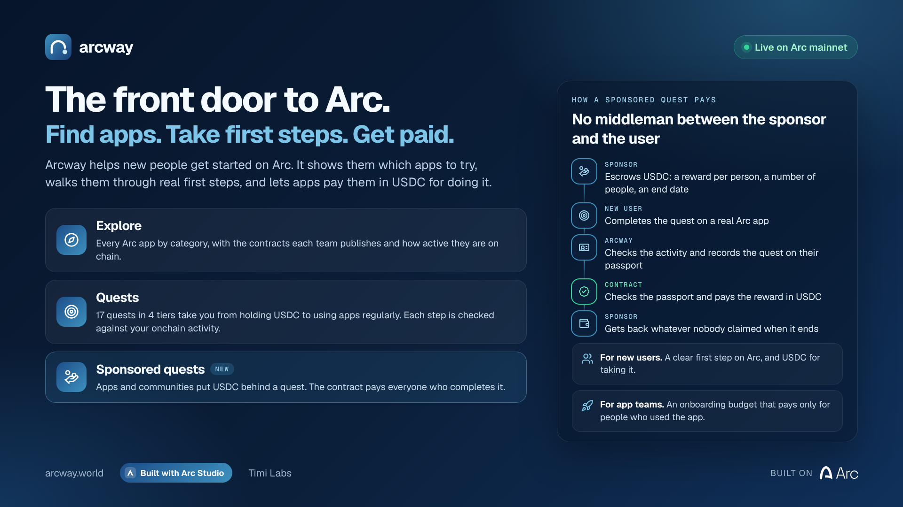
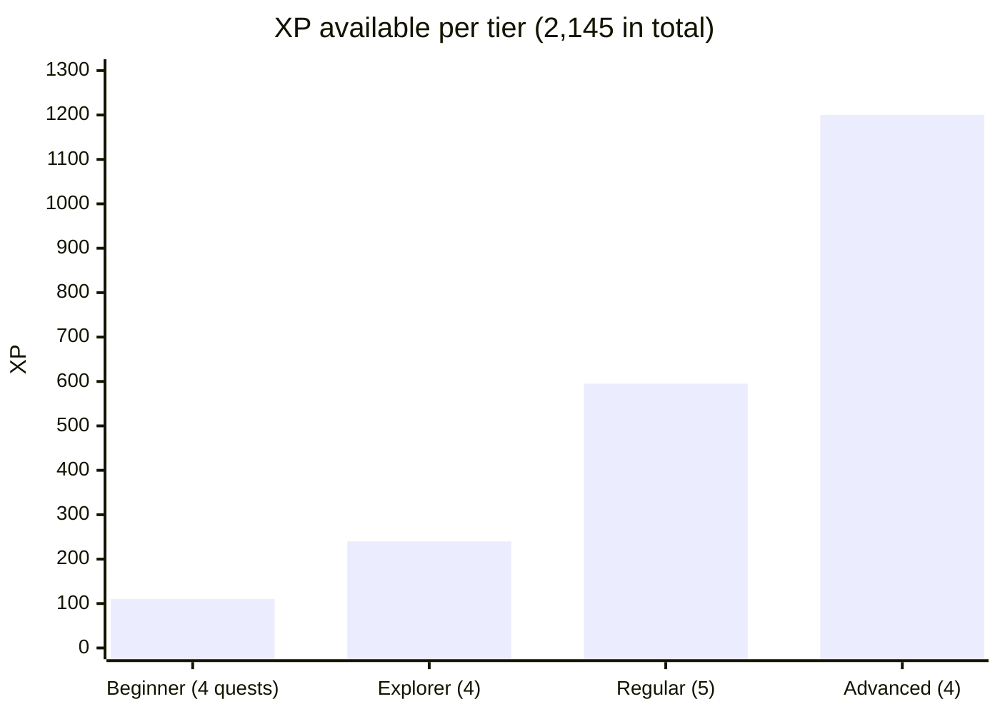
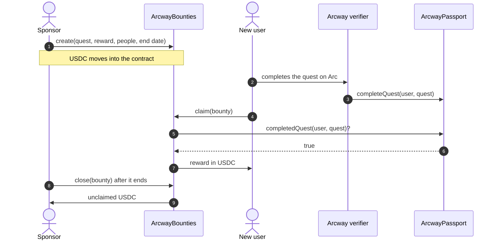
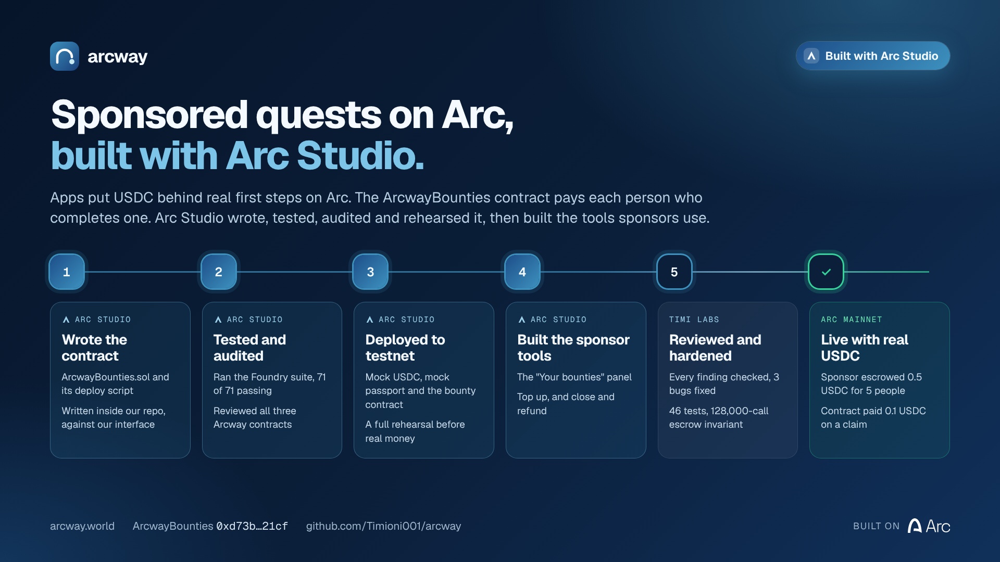
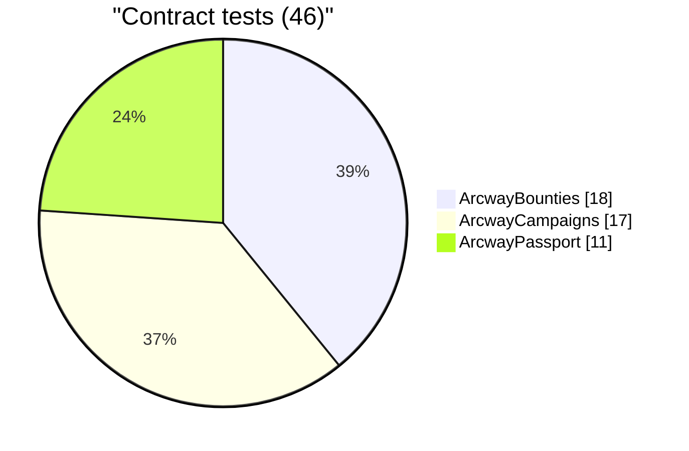
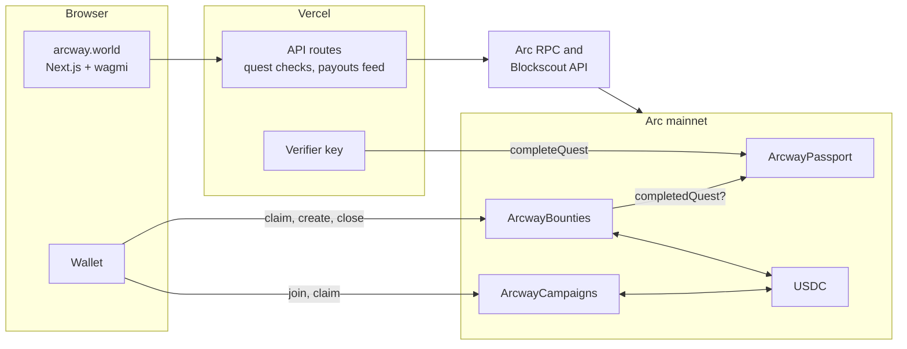

# Arcway

Arcway helps new people get started on Arc. It lists the Arc apps worth trying and walks people through their first real steps with short quests. Apps and communities can put USDC behind those steps, and the ArcwayBounties contract pays each person who completes one.

Live at **[arcway.world](https://arcway.world)** on Arc mainnet (chain 5042). Built by Timi Labs with [Arc Studio](https://studio.arc.io).



## Contents

- [Use Arcway](#use-arcway)
- [How a sponsored quest pays](#how-a-sponsored-quest-pays)
- [Contracts on Arc mainnet](#contracts-on-arc-mainnet)
- [Built with Arc Studio](#built-with-arc-studio)
- [How it fits together](#how-it-fits-together)
- [Run it locally](#run-it-locally)
- [Code map](#code-map)

## Use Arcway

### If you're new to Arc

1. Open [arcway.world](https://arcway.world) and connect a wallet. If you don't have one, [Get a wallet](https://arcway.world/wallet) points you to wallet apps that work with Arc.
2. Browse [Explore](https://arcway.world/apps) to see Arc apps by category, with the contracts each team publishes and how active they are.
3. Open [Quests](https://arcway.world/quests) and start with "Arrive on Arc". Each quest tells you what to do and checks it against your onchain activity.
4. When a quest shows "Ready to claim", claim the XP. Arcway records it on your passport.
5. If the quest card says "Pays X USDC", open the quest and tap Claim. The contract sends the USDC to your wallet.

### If you want to sponsor a quest

1. Open [Sponsor](https://arcway.world/sponsor) and connect a wallet holding USDC on Arc.
2. Pick a quest, the reward per person, how many people and how many days it runs. The page shows the total you escrow.
3. Approve USDC, then create the bounty. Both steps are wallet transactions.
4. Watch claims arrive under "Latest payouts". Under "Your bounties" you can top up while it runs, or close it after it ends and take back what nobody claimed.

### If you build an Arc app

- [For Builders](https://arcway.world/submit) lists your app on Explore. Contract addresses are checked on the explorer.
- [Launch a campaign](https://arcway.world/launch) to lock a USDC prize pool for people who try your app.
- [Badges](https://arcway.world/widgets) gives you a live "on Arc" badge for your site or README.

### The quest path

Quests come in four tiers. Each tier opens after the last quest of the tier before it.



## How a sponsored quest pays



ArcwayBounties has no owner, admin, pause, fee or upgrade path. It calls two contracts: USDC, and the passport's `completedQuest` view. Each wallet claims once per bounty, and the contract rejects tokens that take a fee on transfer.

## Contracts on Arc mainnet

| Contract | Address | What it does |
| --- | --- | --- |
| ArcwayBounties | [`0xd73b798a93497a0e45e2482ad07f7127f00521cf`](https://explorer.arc.io/address/0xd73b798a93497a0e45e2482ad07f7127f00521cf) | Holds sponsors' USDC and pays each wallet that completed the quest |
| ArcwayPassport | [`0xF51812CF4e7f554eFA8ea61A958e8B68B63eD94c`](https://explorer.arc.io/address/0xF51812CF4e7f554eFA8ea61A958e8B68B63eD94c) | Records completed quests and XP |
| ArcwayCampaigns | [`0x229f7A3bbd861149bfF05EAACa186e7ffaEEc26c`](https://explorer.arc.io/address/0x229f7A3bbd861149bfF05EAACa186e7ffaEEc26c) | Holds campaign prize pools |

USDC on Arc is `0x3600000000000000000000000000000000000000`.

Two mainnet transactions show the full loop:

- A sponsor escrows 0.5 USDC for 5 people: [`0xd0516b5f…cc6b`](https://explorer.arc.io/tx/0xd0516b5fbec7016b9b9cf6907fd0c7f18e425e0637f0cb56aae1f500caf2cc6b).
- A wallet that completed the quest claims 0.1 USDC: [`0x018309c1…c0a2`](https://explorer.arc.io/tx/0x018309c1961b3f7b82f7479754a8b0fa1a61af6d8b075fff50d6aa7f848bc0a2).

## Built with Arc Studio



We used Arc Studio on this repo for the sponsored-quest feature ([Studio project](https://studio.arc.io/app/3d0d866c-f38c-4a6a-9c6c-d7c1bbf8f9cf)).

1. Studio read the repo and wrote `contracts/src/ArcwayBounties.sol` and `contracts/script/DeployBounties.s.sol` against our interface, `contracts/src/interfaces/IArcwayBounties.sol` ([commits](https://github.com/Timioni001/arcway/commits/arc-studio/bounties)).
2. Studio ran the Foundry suite, reviewed ArcwayBounties and the two live contracts for security issues, and deployed all three to Arc testnet with a mock USDC and a mock passport.
3. Studio built the sponsor tools on /sponsor: the "Your bounties" panel with top up and close and refund ([commits](https://github.com/Timioni001/arcway/commits/arc-studio/sponsor-tools)).
4. We checked each finding against the source and wrote up the results in [`contracts/AUDIT.md`](contracts/AUDIT.md). We fixed three bugs in the panel during review, and we grew the suite to 46 tests, including an invariant that ran 128,000 random calls and confirmed the contract always holds exactly what open bounties owe.
5. We deployed the same contract to mainnet. Its onchain code matches the tested build byte for byte.



The /sponsor page shows the same credit, with links to the source, the audit and Studio's commits.

## How it fits together



- The browser reads contracts directly with wagmi and viem, and the wallet signs every transaction that moves USDC.
- The server checks quest progress against Arc data and signs `completeQuest` with the verifier key. It never holds user funds.
- The payout feed reads ArcwayBounties events through Arc RPC, and the explorer data comes from the Blockscout API.

Every number on the site shows where it came from: "observed" means read from Arc, "derived" means calculated from observed data with the method shown, and "project-provided" means it comes from the app's listing. When Arc data can't be reached, the page says so and shows nothing. Arcway does not estimate TVL, volume or user counts.

## Run it locally

```bash
npm install
cp .env.example .env.local   # defaults to Arc testnet
npm run dev
```

Checks:

```bash
npm run typecheck
npm test                              # unit tests
npm run build && npm run test:e2e     # browser tests at desktop and phone sizes
cd contracts && forge install foundry-rs/forge-std --no-git && forge test
```

CI runs all of these on every push, and also checks that `lib/bountiesBytecode.ts` matches a fresh `forge build`.

Without `NEXT_PUBLIC_PASSPORT_CONTRACT` and `VERIFIER_PRIVATE_KEY`, the app still detects quest progress but doesn't record it, and tells people recording opens soon. On mainnet, the app uses the ArcwayBounties address above unless `NEXT_PUBLIC_BOUNTIES_CONTRACT` overrides it.

`docs/DEPLOYMENT.md` covers Vercel, environment variables and the contracts. To deploy ArcwayBounties without a terminal, open `/deploy/bounties` in a wallet app's browser. The page uses the exact bytecode that `forge test` tested, and after the deploy it reads back the contract's USDC and passport addresses to confirm them.

## Tech

| Layer | What we use |
| --- | --- |
| Contracts | Solidity 0.8.30, Foundry, native USDC on Arc |
| App | Next.js 16, React, TypeScript, wagmi, viem, TanStack Query |
| Wallets | Browser and mobile wallets; Circle Modular Wallets passkey support, off until a client key is set |
| Data | Arc RPC (Blockdaemon first for log scans), Blockscout API, optional Envio indexer in `indexer/` |
| Tests | Foundry, Vitest, Playwright at desktop and phone sizes |
| Built with | Arc Studio for ArcwayBounties and the sponsor tools |

## Code map

- `contracts/src/` has ArcwayBounties, ArcwayPassport and ArcwayCampaigns, with tests in `contracts/test/`.
- `lib/quests.ts` defines the quests, tiers and XP. `lib/server/verify.ts` checks them on chain.
- `lib/bounties.ts`, `lib/hooks/useBounties.ts` and `components/Bounties.tsx` contain the sponsored-quest logic and UI. `lib/server/bountyActivity.ts` feeds the payout list.
- `lib/registry.ts` lists the apps. Add an entry to list a new one, and only list contracts the team publishes.
- `lib/config.ts` holds the chain, USDC, contract addresses and explorer links.
- `marketing/demo/` has the demo video pipeline, the script and the images above.
- `docs/` has the architecture, product, data, contracts and UI notes.

## Brand

The Arc logo in `public/brand/arc/` is Circle's official file, used unmodified for "Built on Arc" attribution. See `public/brand/arc/NOTICE.md`. Arcway is independent and not affiliated with Circle.
